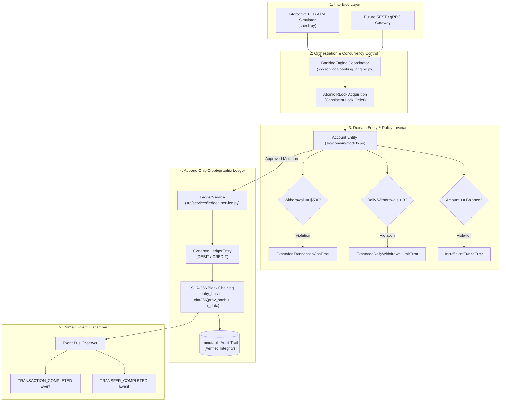

# 🏦 PyBank: Event-Driven Core Banking Engine & Cryptographic Ledger

[](https://www.python.org/)
[](src/domain/)
[](src/services/ledger_service.py)
[](tests/)
[](tests/test_concurrency.py)
[](https://github.com/astral-sh/ruff)
[](Dockerfile)
[](LICENSE)

> Mission-critical, thread-safe core banking transactional engine built on **Double-Entry Ledger accounting**, **cryptographic SHA-256 audit chaining**, and **in-memory ACID compliance**.

---

## 🎯 Executive Overview

Core banking software requires uncompromising mathematical correctness. Naive balance mutations suffer from severe production vulnerabilities:
1. **Race Conditions & Double-Spending:** Concurrent API requests or ATM debits can read stale balances, creating negative accounts.
2. **Untracked Financial Leakage:** Modifying balances directly without balancing credit/debit ledger entries creates un-auditable discrepancies.
3. **Data Tampering:** Without cryptographic chaining, malicious database updates cannot be detected during compliance audits (SOC2 / Basel III).

**PyBank** is a high-performance, zero-external-dependency transaction engine engineered in Python. It enforces atomic lock-protected state transitions, records all operations in an append-only cryptographic ledger with continuous SHA-256 integrity verification, and dispatches real-time domain events to auditing subscribers.

---

## 🏗️ System Architecture



---

## 🔐 Core Engineering Guarantees

### 1. Thread-Safety & Race Condition Immunity
Account mutations are protected by re-entrant locks (`threading.RLock`). In concurrent multi-threaded environments, debits cannot execute out-of-order.
- **Automated Stress Test:** In `tests/test_concurrency.py`, 10 simultaneous threads attempt to withdraw $200 from a $600 account. Exactly 3 operations succeed and 7 are safely rejected with `InsufficientFundsError`, guaranteeing zero overdraft or race conditions.

### 2. Cryptographic Hash-Chain Integrity
Every `LedgerEntry` links to its predecessor via SHA-256 cryptographic hashing:
$$\text{entry\_hash} = \text{SHA256}(\text{prev\_hash} : \text{id} : \text{account} : \text{type} : \text{amount} : \text{balance} : \text{timestamp})$$
Calling `ledger.verify_ledger_integrity()` traverses the history from genesis (`0` $\times 64$) to head. If any historical record, amount, or balance is altered, the chain breaks immediately with `LedgerCorruptionError`.

### 3. Deadlock-Free Multi-Account Transfers
Bilateral transfers acquire locks based on sorted account identifiers:
```python
first, second = sorted([source, target], key=lambda a: a.account_id)
with first._lock:
    with second._lock:
        # Atomic debit and credit
```
This guarantees strict deadlock avoidance regardless of concurrent reverse transfers between the same parties.

---

## 🚀 Quickstart & Execution

### Prerequisites
- Python 3.10, 3.11, or 3.12 (Zero external runtime dependencies required)
- Optional: Docker

### Local Installation
```bash
# 1. Clone repository
git clone https://github.com/jAk7star/pybank-transaction-engine.git
cd pybank-transaction-engine

# 2. Setup virtual environment
python -m venv .venv
source .venv/bin/activate  # Windows: .venv\Scripts\Activate.ps1

# 3. Install developer tooling (Pytest & Ruff)
pip install -r requirements-dev.txt

# 4. Run the automated test suite
pytest -v

# 5. Launch the interactive ATM & Ledger terminal
python -m src.cli
```

### Running with Docker
```bash
# Build container image
docker build -t pybank-engine .

# Run automated tests inside container
docker run --rm pybank-engine
```

---

## 📁 Repository Structure

```text
pybank-transaction-engine/
├── .github/workflows/
│   └── ci.yml                 # Automated testing and multi-version Python CI
├── src/
│   ├── __init__.py
│   ├── cli.py                 # Interactive ATM console and statement viewer
│   ├── domain/
│   │   ├── __init__.py
│   │   ├── exceptions.py      # Domain-specific banking exceptions
│   │   └── models.py          # Account entity, LedgerEntry, and transaction enums
│   └── services/
│       ├── __init__.py
│       ├── banking_engine.py  # High-level coordinator and transfer engine
│       └── ledger_service.py  # Append-only ledger with SHA-256 verification
├── tests/
│   ├── __init__.py
│   ├── test_account.py        # Deposit and invariant unit tests
│   ├── test_banking_engine.py # Bilateral transfer tests
│   ├── test_concurrency.py    # Multi-threaded concurrent race condition tests
│   ├── test_ledger.py         # Hash chaining and tampering detection tests
│   └── test_policies.py       # Daily velocity and transaction cap tests
├── Dockerfile                 # Container deployment specification
├── pyproject.toml             # Ruff and Pytest configuration
├── requirements.txt           # Pure standard library runtime (zero dependencies)
├── requirements-dev.txt       # Pytest & Ruff development tools
├── sistema_bancario.py        # Backwards-compatible legacy entrypoint
└── README.md                  # Executive architecture documentation
```

---

## 👨‍💻 Author

**Jaques Gabriel Amaral Nunes**  
Data & AI Engineer  
- GitHub: [@jAk7star](https://github.com/jAk7star)  
- Email: [jaquesgabrielamaral@gmail.com](mailto:jaquesgabrielamaral@gmail.com)
